# Bug Fixes

All 7 bugs fixed. Notes on each change below.

---

## Fix 1: Payment amount returned as string (Bug A)

**Files Changed:** src/routes/payment.routes.js (lines 16, 52)

**Code Changes:**
```diff
- amount: p.amount.toString(),
+ amount: p.amount, // keep it numeric, .toString() was breaking frontend math
```
```diff
- amount: payment.amount.toString(),
+ amount: payment.amount,
```

**Why This Fix:**  
The DB already stores it as a float. `.toString()` was converting it for no reason.
Removed it on both the list and single-payment endpoints.

**Testing:**
```bash
# Fetch payments — amount is now numeric (25.5) instead of string ("25.5")
curl http://localhost:3000/api/payments -H "Authorization: Bearer <token>"

# Single payment endpoint also returns numeric amount
curl http://localhost:3000/api/payments/1 -H "Authorization: Bearer <token>"
```

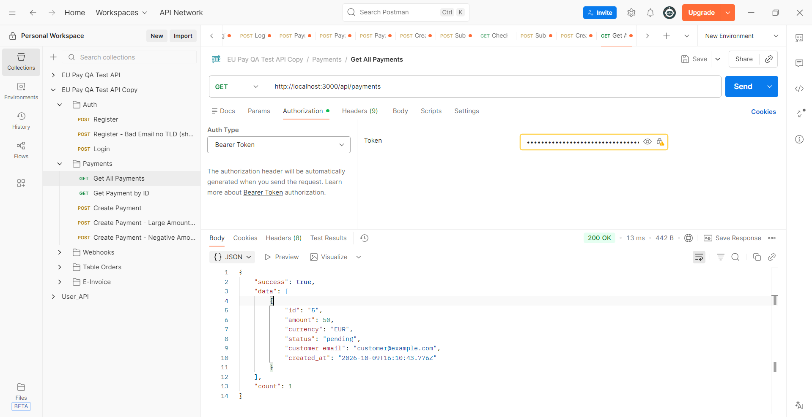

---

## Fix 2: No maximum amount limit on payments (Bug B)

**Files Changed:** src/routes/payment.routes.js (~line 75)

**Code Changes:**
```diff
+ // payment processors cap single transactions — 50k EUR is the standard limit
+ // anything above this gets rejected by Powens anyway, better to catch it here
+ if (amount > 50000) {
+   return res.status(400).json({ error: 'Amount exceeds maximum allowed per transaction (€50,000)' });
+ }
```

**Why This Fix:**  
€50,000 is a widely used cap for single transactions. Without this, a bad request
(or malicious actor) could create payment records that would get rejected by the
provider but leave garbage in the DB.

**Testing:**
```bash
# Exceeds limit — should be rejected with 400
curl -X POST http://localhost:3000/api/payments \
  -H "Authorization: Bearer <token>" \
  -H "Content-Type: application/json" \
  -d '{"amount": 99999, "currency": "EUR", "customer_email": "customer@example.com"}'
# Returns 400: "Amount exceeds maximum allowed per transaction (€50,000)"

# Valid amount under limit — should succeed with 201
curl -X POST http://localhost:3000/api/payments \
  -H "Authorization: Bearer <token>" \
  -H "Content-Type: application/json" \
  -d '{"amount": 50.00, "currency": "EUR", "customer_email": "customer@example.com"}'
# Returns 201 Created
```

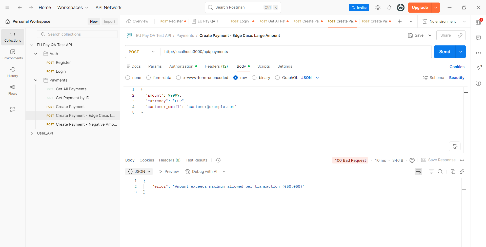


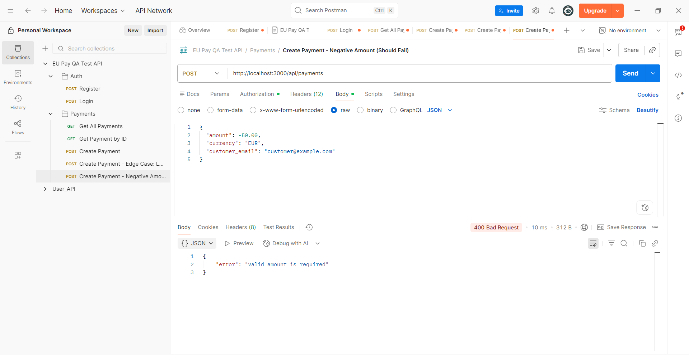

---

## Fix 3: Email regex allowed addresses without a TLD (Bug C)

**Files Changed:** src/routes/auth.routes.js (line 12)

**Code Changes:**
```diff
- const emailRegex = /^[^\s@]+@[^\s@]+$/;
+ const emailRegex = /^[^\s@]+@[^\s@]+\.[^\s@]+$/;
```

**Why This Fix:**  
Added `\.[^\s@]+` to the domain portion. This requires at least one dot in the
domain, so `user@domain` fails but `user@domain.com` passes. Not a perfect RFC 5322
validator but covers real-world cases without being overly strict.

**Testing:**
```bash
# Should fail now
curl -X POST http://localhost:3000/api/auth/register \
  -H "Content-Type: application/json" \
  -d '{"email":"user@domain","password":"Test123!","business_name":"Test Co"}'
# Returns 400: "Invalid email format"

# Should still work
curl -X POST http://localhost:3000/api/auth/register \
  -H "Content-Type: application/json" \
  -d '{"email":"user@domain.com","password":"Test123!","business_name":"Test Co"}'
# Returns 201
```

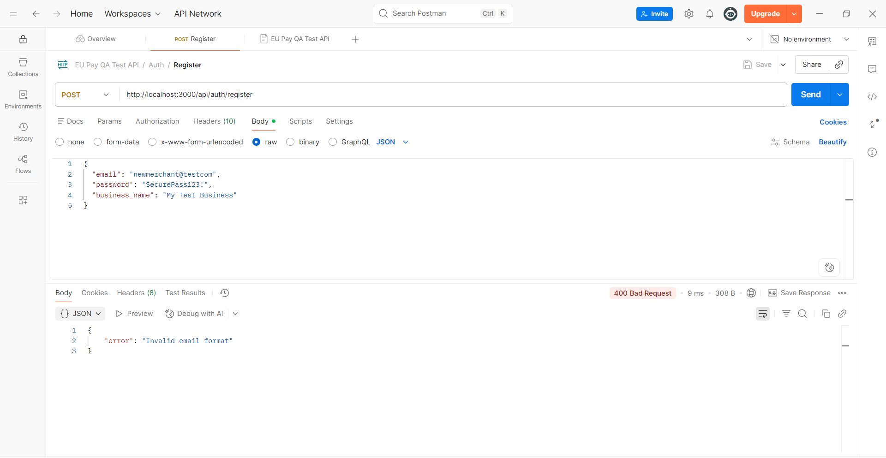

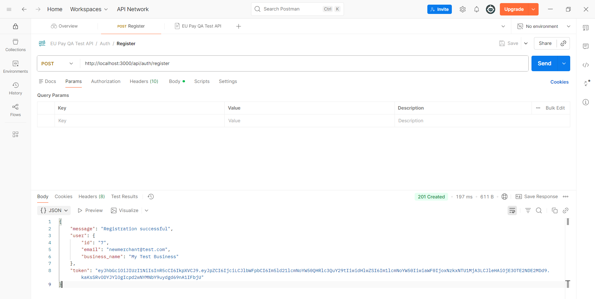


---

## Fix 4: Webhook signature not verified (Bug D)

**Files Changed:** src/routes/webhook.routes.js (lines 21-32)

**Code Changes:**
```diff
- // BUG D: No signature verification (commented out)
+ // without this anyone can spoof a payment status update
+ const expectedSignature = crypto
+   .createHmac('sha256', WEBHOOK_SECRET)
+   .update(JSON.stringify(req.body))
+   .digest('hex');
+
+ if (signature !== expectedSignature) {
+   return res.status(401).json({ error: 'Invalid signature' });
+ }
```

**Why This Fix:**  
The verification logic was already written and just commented out. Enabled it.
Uses HMAC-SHA256 with the shared secret — same approach Stripe, Powens and
most payment providers use.

**Testing:**
```bash
# Fake signature — should get 401
curl -X POST http://localhost:3000/api/webhooks/payment-status \
  -H "Content-Type: application/json" \
  -H "x-webhook-signature: fakesig" \
  -d '{"payment_id":"1","status":"completed","event_id":"evt_1"}'

# To test with a valid signature, generate it:
# node -e "const c=require('crypto'); console.log(c.createHmac('sha256','test-webhook-secret-key').update(JSON.stringify({payment_id:'1',status:'completed',event_id:'evt_1'})).digest('hex'))"
```

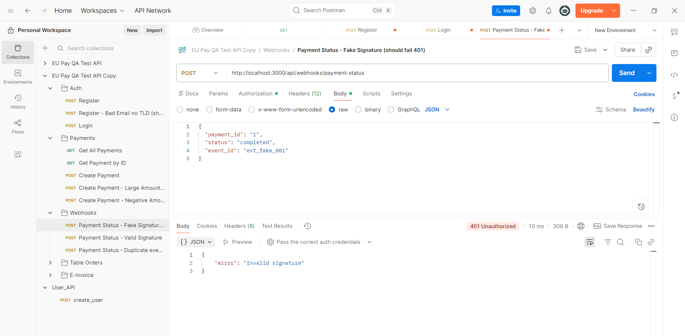

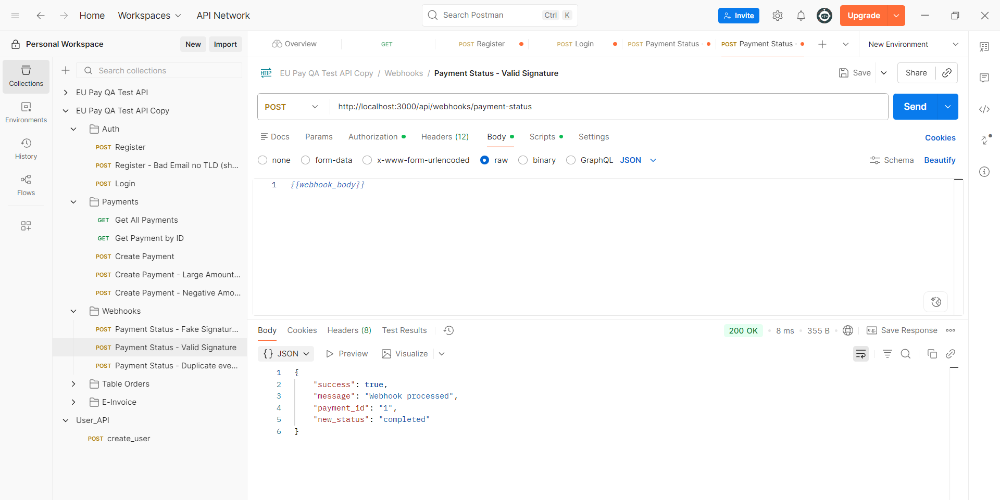


---

## Fix 5: Duplicate webhooks reprocessed (Bug E)

**Files Changed:** src/routes/webhook.routes.js (lines 38-44, 56)

**Code Changes:**
```diff
+ // webhooks get retried a lot — don't process the same event_id twice
+ if (event_id && db.processed_webhooks.includes(event_id)) {
+   return res.status(200).json({ message: 'Already processed' });
+ }
  
  // ... after processing:
- // db.processed_webhooks.push(event_id);
+ if (event_id) db.processed_webhooks.push(event_id);
```

**Why This Fix:**  
`db.processed_webhooks` was already there and the push was already written —
just commented out. Added the check before processing and enabled the push after.
Returns 200 (not 4xx) on duplicate so the provider doesn't keep retrying.

**Testing:**
```bash
# First call — should process
# Second call with same event_id — should return {"message":"Already processed"}
```

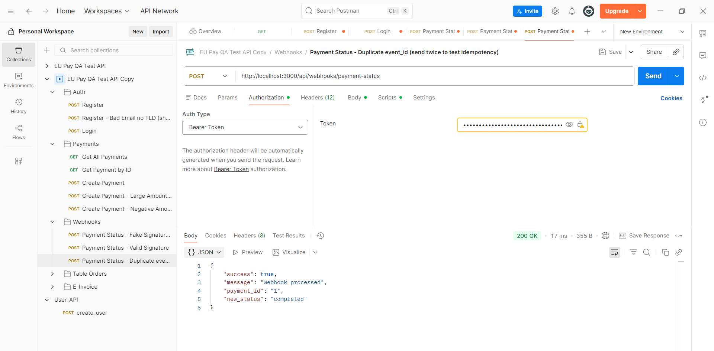

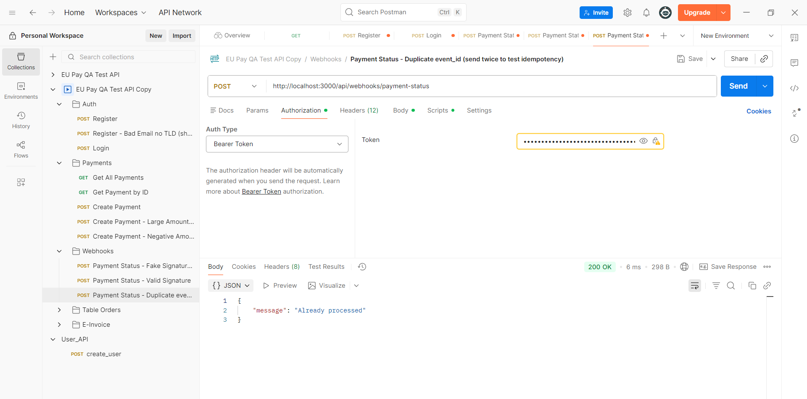


---

## Fix 6: Duplicate pending orders for same table (Bug F)

**Files Changed:** src/routes/table-order.routes.js (~line 44)

**Code Changes:**
```diff
+ // don't let the same table stack up multiple pending orders
+ const existingOrder = (db.table_orders || []).find(
+   o => o.merchant_id === merchant_id &&
+        o.table_number === table_number &&
+        o.status === 'pending'
+ );
+ if (existingOrder) {
+   return res.status(409).json({ error: 'Table already has a pending order' });
+ }
```

**Why This Fix:**  
Without this, rapid-clicking on the "Order" button (or a network retry) would
create multiple orders for the same table. Kitchen gets two tickets, customer
gets charged twice. Checks merchant + table + pending status so different merchants
sharing table numbers don't interfere.

**Testing:**
```bash
# Create an order for table 5
# Try to create another order for table 5 — should get 409
# Update first order to "served", then creating another should work fine
```

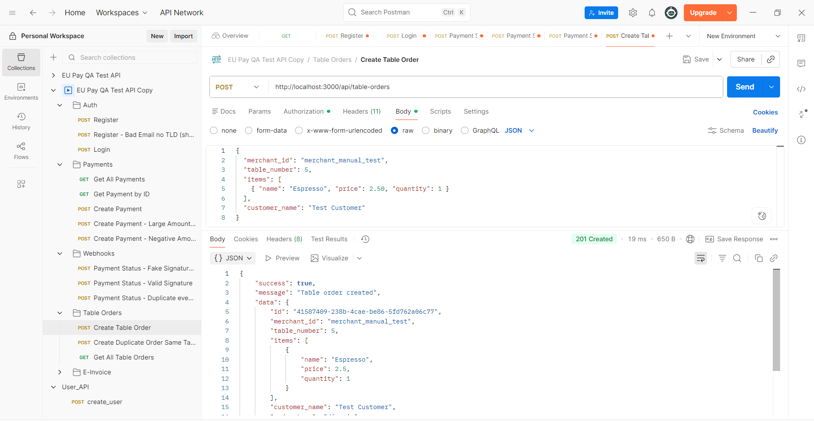

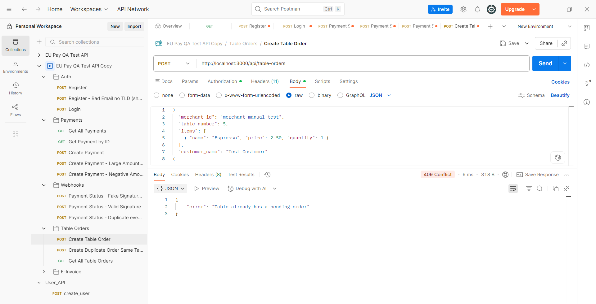


---

## Fix 7: E-invoice can be submitted to tax authority multiple times (Bug G)

**Files Changed:** src/routes/einvoice.routes.js (~line 50)

**Code Changes:**
```diff
+ // submitting the same invoice twice to the tax authority causes duplicate filing issues
+ if (invoice.einvoice_status === 'submitted' || invoice.einvoice_status === 'accepted') {
+   return res.status(409).json({ error: 'Invoice already submitted to tax authority' });
+ }
```

**Why This Fix:**  
Checks both `submitted` and `accepted` — either state means it's already in the
tax authority's system. Without this, each call would generate a new `submission_id`
and overwrite the original, making it impossible to track which submission actually
went through.

**Testing:**
```bash
# Submit invoice_001 — get 200
# Submit invoice_001 again — get 409 "Invoice already submitted"
```

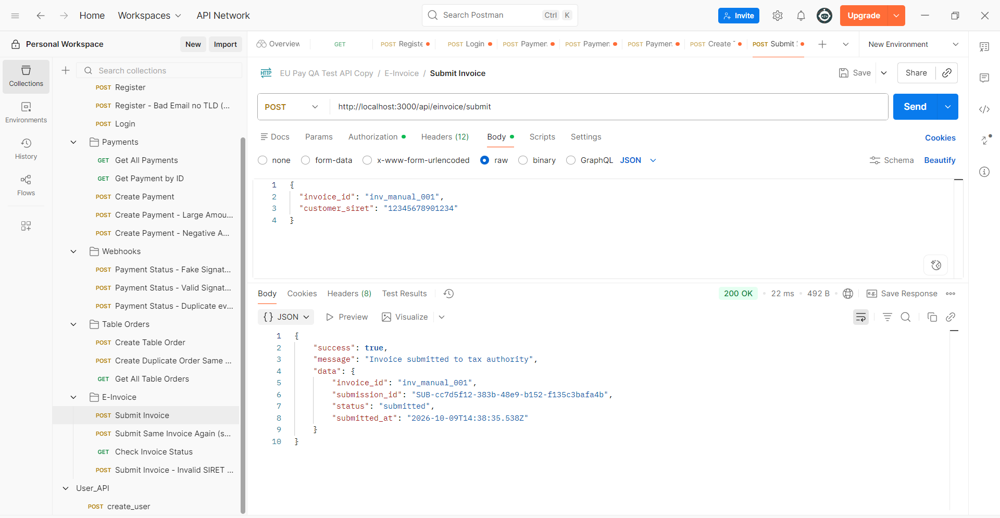

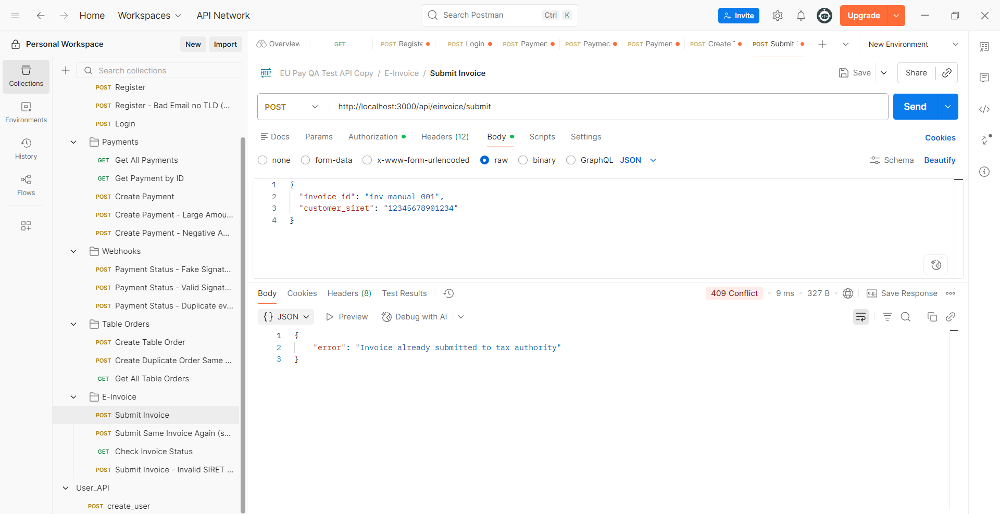

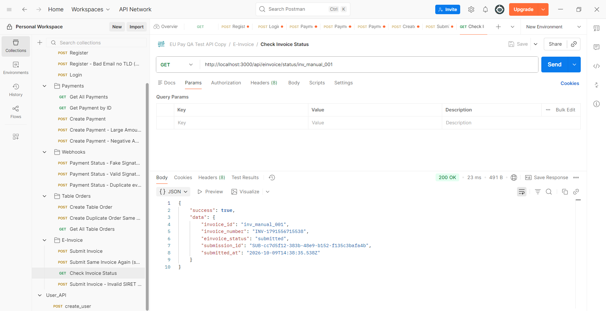

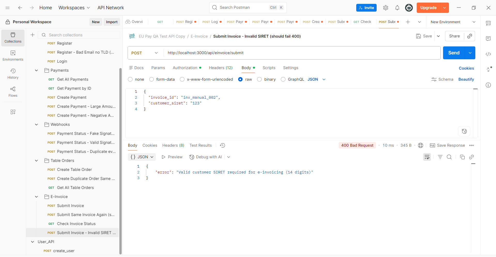

