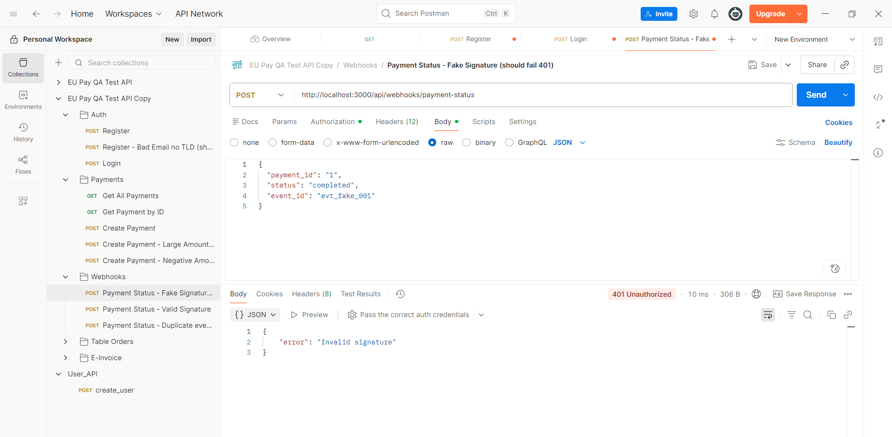
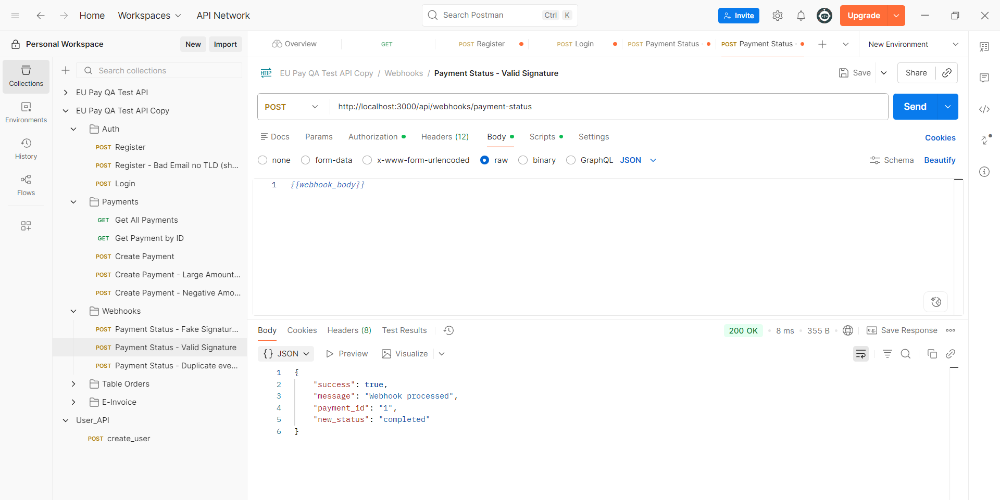
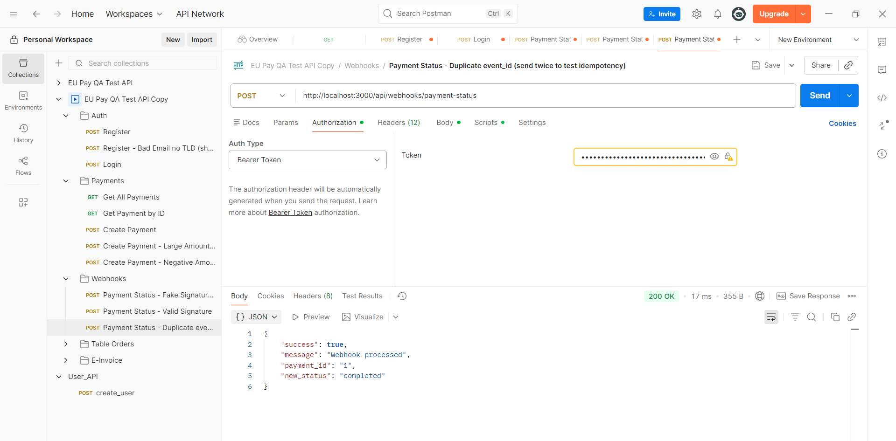
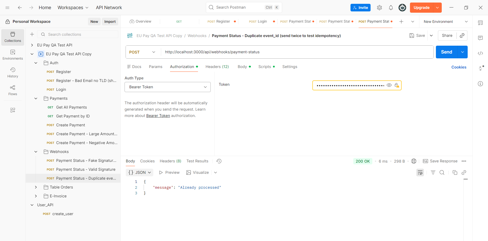

# Test Plan — Webhook Payment Flow

Comprehensive test plan for the payment webhook processing flow (`POST /api/webhooks/payment-status`).

---

## 1. Test Scope

### What We're Testing
- Webhook ingestion endpoint (`POST /api/webhooks/payment-status`)
- HMAC-SHA256 signature verification (`x-webhook-signature` header)
- Idempotency handling — duplicate webhooks with the same `event_id`
- Payment record lookup and status transitions (`pending` -> `completed` / `failed`)
- Malformed payloads, missing required fields, and injection attempts
- Database persistence after status updates
- Socket.IO event emission to connected frontend clients

### What We're NOT Testing
- Frontend UI dashboard or checkout widget rendering (covered in separate UI tests)
- High-volume stress / load testing (e.g. k6 benchmark with thousands of concurrent users)
- Upstream payment provider internals (Powens / Stripe gateway internal banking rails)
- Settlement delays between banks (SEPA / credit card clearance timelines)

---

## 2. Test Environment

- **API Host:** `http://localhost:3000`
- **Webhook Simulator:** Postman collection (`postman-collection.json` with pre-request HMAC calculation script) + curl scripts
- **Shared Secret:** `test-webhook-secret-key` (set in environment)
- **Database:** In-memory mock database (`src/db/index.js`). Resets on server restart, so tests seed a payment before running scenarios.
- **Test Framework:** Node.js built-in test runner (`node --test`) for automated integration tests

---

## 3. Test Scenarios

Minimum 12 core test scenarios covering standard flows, failure paths, and edge cases:

| ID | Scenario | Input / Setup | Expected Result | Priority |
|---|---|---|---|---|
| **TC-01** | Valid webhook with correct signature | Valid payment in DB, correct HMAC-SHA256 header, body with `status: "completed"` | `200 OK`, `success: true`, payment status updated to `completed` in DB | High |
| **TC-02** | Webhook with fake / missing signature | Valid payload but `x-webhook-signature: "invalid_sig"` or missing header | `401 Unauthorized`, `error: "Invalid signature"`, DB payment unchanged | High |
| **TC-03** | Duplicate webhook (same `event_id` twice) | Send valid webhook with `event_id: "evt_100"` twice in succession | 1st request: `200 OK` (processed). 2nd request: `200 OK` with `message: "Already processed"`, no duplicate updates | High |
| **TC-04** | Webhook for non-existent payment ID | Valid signature, but `payment_id: "999999"` which doesn't exist in DB | `404 Not Found`, `error: "Payment not found"` | Medium |
| **TC-05** | Webhook arrives before payment record exists | Race condition where provider sends webhook before DB insert finishes | Returns `404` currently. In production, needs a retry queue with backoff | Medium |
| **TC-06** | Multiple status transitions for same payment | Send `status: "processing"`, then send `status: "completed"` for payment `1` | Both accepted in order, payment state reflects final status | Medium |
| **TC-07** | Missing required fields in payload | Omit `payment_id` or `status` from request body | `400 Bad Request`, error message indicating missing field | High |
| **TC-08** | Malformed JSON payload | Send broken JSON string (e.g. missing closing brace `{"payment_id":"1"`) | `400 Bad Request` returned by JSON body parser before handler executes | High |
| **TC-09** | Concurrent webhooks for same event | Fire two requests with identical `event_id` simultaneously using `Promise.all` | Exactly one processes successfully; the other hits idempotency check, avoiding race conditions | High |
| **TC-10** | SQL / NoSQL injection in `payment_id` | `payment_id: "' OR '1'='1"` or `{"$gt": ""}` | `404 Not Found`, treated strictly as literal string search, no server crash | High |
| **TC-11** | Timing attack on signature check | Measure response latency differences with varying prefixes of valid signatures | String comparison must be constant-time (`crypto.timingSafeEqual`) to prevent side-channel leaks | Medium |
| **TC-12** | Replay attack with captured webhook | Re-sending an old captured payload hours later | Blocked by `event_id` cache. If cache expired, timestamp validation should reject events older than 5 minutes | Medium |

---

## 4. Security Tests

### 4.1 HMAC-SHA256 Signature Verification
- **Test:** Verify `x-webhook-signature` header against HMAC of raw body using `test-webhook-secret-key`.
- **Cases:**
  1. Header missing entirely → `401 Unauthorized`
  2. Header has random fake hex → `401 Unauthorized`
  3. Header computed with wrong secret key → `401 Unauthorized`
  4. Header matches but body payload altered by 1 character → `401 Unauthorized`
- **Current status:** Implemented and verified in Task 2 & Task 3.

### 4.2 Replay Attack Prevention
- **Test:** Capture a genuine, valid webhook request and replay it.
- **Result:** First delivery processes successfully (`200 OK`). Any subsequent replay returns `200 OK` with `"Already processed"` because `event_id` is tracked in `db.processed_webhooks`.
- **Production Note:** The current in-memory array wipes on restart. In production this needs Redis with a 24-48 hour TTL.

### 4.3 Payload Injection & Sanitization
- **SQL Injection:** Pass `' UNION SELECT * FROM users --` as `payment_id`. Since the DB is in-memory array `find()`, it safely treats it as a string literal and returns `404`.
- **XSS in Status Field:** Pass `` in the status field. Ensure the API does not execute or echo unescaped HTML to frontend clients or logs.

---

## 5. Edge Cases

- **Very large `payment_id` / payload size:** Send a 10KB string for `payment_id`. Ensure the server responds with `404` or `413 Payload Too Large` without crashing or hanging the event loop.
- **Unicode characters in payload:** Send payment updates with UTF-8 characters (`€`, `café`, Chinese characters in notes). Verify HMAC digest correctly handles UTF-8 encoding so valid signatures aren't rejected.
- **Null / empty `event_id`:** Send `{ payment_id: "1", status: "completed", event_id: "" }`. Verify the server handles it without pushing empty strings into `db.processed_webhooks`.
- **Future / skewed timestamps:** If timestamps are added to webhook headers, reject requests dated more than 5 minutes in the future or past to counter replay attempts.

---

## 6. Integration Tests

- **Webhook → Payment Status Update → DB Persistence:**
  1. Seed payment `pay_integ_1` with status `pending`.
  2. Send signed webhook with `status: "completed"`.
  3. Query `GET /api/payments/pay_integ_1`.
  4. Assert payment status is `completed` and `updated_at` timestamp is updated.
- **Webhook → Socket.IO Event Emission:**
  1. Connect a test WebSocket client to `http://localhost:3000`.
  2. Listen for `payment_status_updated` event.
  3. Send signed webhook.
  4. Assert the socket client receives the event payload within 500ms.
- **Retry Handling for Downstream Failures:**
  1. If payment update fails (e.g. DB connection dropped), webhook endpoint must return `500 Internal Server Error` so provider will retry.
  2. For duplicate events, return `200 OK` so provider stops retrying.

---

## 7. Risk Assessment

| Risk | Impact | Detection | Mitigation |
|---|---|---|---|
| **In-memory cache loss on server crash** | If the app restarts, `processed_webhooks` empties. Replayed webhooks could re-trigger downstream actions. | Webhook logs showing identical `event_id` processed multiple times across restarts. | Store processed `event_id`s in Redis with a 48-hour expiration TTL. |
| **Out-of-order delivery** | "Payment completed" webhook arrives before the order creation API finishes writing to DB, returning 404. | Sentry alerts on 404s for webhook endpoint during checkout spikes. | Implement a dead-letter queue (DLQ) with exponential backoff retry (e.g. retry after 2s, 5s, 15s before giving up). |
| **Signature verification bypass via timing attack** | Standard string comparison `===` exits early on first mismatched character, theoretically leaking valid signatures. | High volume of microsecond-timed requests probing the webhook endpoint. | Use `crypto.timingSafeEqual(Buffer.from(sig), Buffer.from(expected))` instead of `===`. |
| **Webhook secret exposure** | If the webhook secret is checked into git or leaked, attackers can forge fake payment completions. | Sudden influx of payment completions without matching gateway activity. | Store secret in AWS Secrets Manager / Doppler, rotate secrets periodically, and support dual-secret verification during rotations. |
